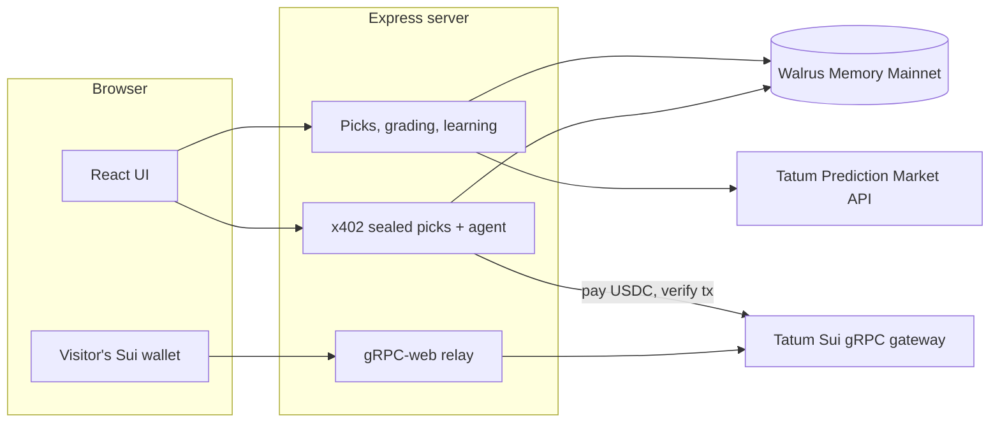

# Receipts

**A pick journal that remembers who was actually right.**

Tipsters on X, Telegram and WhatsApp delete their losing calls and screenshot their wins. Receipts records every pick *before* the event, stores it on [Walrus Memory](https://docs.wal.app/walrus-memory) so it can't be quietly edited or deleted, and builds up credibility for each source from real results.

Built for the Tatum x Walrus **Total Recall** hackathon (Track 01: Markets & Sports Prediction).

## What works today

- **Log a pick** with event, market, side, odds, source and confidence. Each pick becomes a Walrus memory with a blob you can open on Walruscan.
- **Paste a tip**: paste a tipster's post and Receipts pre-fills the form (matchup, spread/total/moneyline/yes-no, odds, units). You confirm before anything is stored.
- **Feed and source leaderboard**, rebuilt from Walrus Memory on every load.
- **Memory inspector** listing every memory the app has written, by namespace, with blob links and progress toward the 10-memory Mainnet requirement.
- **Grading**: mark each open pick Won, Lost or Push. The grade is its own memory; the pick record is never rewritten.
- **Credibility per source × league**: a trust score (win rate pulled toward 50% until there is enough evidence), record, ROI and closing-line value. Every change is a new memory that names the score it supersedes, and the Sources tab shows the full timeline of how Receipts changed its mind.
- **Your own patterns**: once 5 graded picks in a league, market or price range are clearly winning or losing, Receipts remembers it, plus an optional daily loss limit you set.
- **Advice that cites memory**: open picks are ranked by remembered trust, and each advice line links to the Walrus blob it came from.
- **Prediction markets via Tatum** ([Prediction Market API](https://tatum.io/), Polymarket and Kalshi behind one endpoint):
  - Link a pick to a live market from the Log tab; the feed shows the market's live price against the price you picked at.
  - **Check market results** grades every linked pick whose market has settled, with no manual input, and the credibility update follows as usual.
  - **Follow Polymarket's top traders**: load the monthly leaderboard and log a trader's latest buys as picks sourced to them. They grade themselves on settlement, so Receipts finds out whether a leaderboard name is actually worth copying.
- **Pay-per-pick agent (x402 on Sui)**:
  - A tipster *seals* their next pick: the pick stays hidden, and a SHA-256 commitment to it is written to Walrus, which proves it existed before the game.
  - The sealed pick is an x402 resource: `GET /api/x402/offers/:id/pick` answers **402 Payment Required** with the terms (USDC on Sui, amount, recipient).
  - The agent reads the terms and checks the source's remembered trust in that league against your bar and price limit. If both pass, it pays from its own Sui wallet, retries with an `X-PAYMENT` header holding the transaction digest, and logs the revealed pick.
  - The server checks the payment through **Tatum's Sui RPC** before releasing the pick: the transaction succeeded, enough USDC reached the seller, it landed after the offer was created, and the digest hasn't been used before.
  - Every decision, paid or skipped, becomes a Walrus memory with the reason.
  - Visitors can buy a sealed pick themselves: **Connect wallet** (any Sui wallet, via dApp Kit), then **Buy with my wallet** pays the same x402 terms from their wallet. Their wallet reads Sui through the server's Tatum relay (`/api/sui-grpc`, which turns the browser's gRPC-web calls into native gRPC to Tatum; reads, simulation and signed-transaction execution only), so no RPC key reaches the browser. A visitor's pick is shown only to them, not added to the owner's journal.
- **Sui wallet reader** for SUI and USDC balances through the Tatum Sui Mainnet gRPC gateway.


## Architecture



The loop, end to end:

1. **Record.** A pick (typed, pasted from a tip, linked to a Polymarket market, or copied from a top trader's trade) becomes a memory in `receipts-picks` before the event starts.
2. **Grade.** When the market settles, Tatum's Prediction Market API says who won and Receipts writes a grade memory; manual grades work the same way. Nothing is overwritten: a correction is a newer grade.
3. **Learn.** Each grade moves the source's trust in that league, written to `receipts-credibility` as a new memory that names the score it replaces, and spots patterns in your own picks (`receipts-profile`).
4. **Act on memory.** Advice cites the memories it comes from. The pay-per-pick agent reads a sealed pick's x402 terms, recalls the tipster's trust, and pays in USDC on Sui only if it clears your bar; the payment is verified through Tatum's Sui gRPC gateway before the pick is released, and the decision and its reason go to `receipts-payments`.

Sealed picks commit to their content up front: a SHA-256 of the hidden pick plus a salt is written to Walrus when it is sealed, so after the reveal anyone can check it wasn't changed after the result.

## Live demo

The hosted demo runs on Walrus Memory Mainnet and Sui mainnet in read-only mode for visitors:

- **Feed, Sources and Memory** show every pick, grade, trust score and the Walrus blob behind each one.
- **Agent → Connect Wallet → Buy with my wallet** lets you pay a sealed pick's x402 price (0.05 USDC) from your own Sui wallet and see the pick. You need a little USDC and SUI for gas.
- Logging, grading, sealing and running the agent need the owner passcode.

## How memory is used

| Namespace | What is stored |
|---|---|
| `receipts-picks` | One memory per pick: a readable sentence for semantic recall, plus the exact JSON record |
| `receipts-grades` | One memory per grade; the newest grade for a pick decides its status |
| `receipts-credibility` | Credibility scores per source × league (append-only: a new score supersedes the old one) |
| `receipts-profile` | Patterns in the user's journal and their daily loss limit |
| `receipts-payments` | Sealed-pick commitments and every agent payment decision (paid or skipped, and why) |

Records are never edited. Grading a pick writes a new record; the newest record per pick wins.

## Run it locally

Requires Node 22.9+.

```bash
npm install
cp .env.example .env   # fill in your keys
npm run dev            # http://localhost:3000
```

No keys yet? `npm run dev:mock` runs the whole app against an in-memory mock of Walrus Memory (nothing is stored) recorded Tatum prediction market responses, and fake Sui payments.

### Environment

| Variable | Purpose |
|---|---|
| `TATUM_API_KEY` | Tatum API key ([dashboard](https://dashboard.tatum.io/)) for the Prediction Market API and the Sui gRPC gateway |
| `MEMWAL_PRIVATE_KEY` | Walrus Memory delegate private key |
| `MEMWAL_ACCOUNT_ID` | Walrus Memory account object ID |
| `MEMWAL_NETWORK` | `testnet` (default) or `mainnet` |
| `MEMWAL_SERVER_URL` | Optional relayer override |
| `MEMWAL_MOCK` | `1` to use the in-memory mock |
| `PAYMENTS_NETWORK` | `mainnet` (default) or `testnet` for x402 payments |
| `AGENT_SUI_PRIVATE_KEY` | The agent's own Sui wallet (`node scripts/new-agent-wallet.mjs` makes one) |
| `SELLER_SUI_ADDRESS` | Default recipient for sealed-pick payments |
| `AGENT_MIN_TRUST`, `AGENT_MAX_PRICE_USDC` | Default spending rule (55 and 0.25) |
| `PAYMENTS_MOCK` | `1` to fake the chain; nothing is paid |
| `PREDICTION_MOCK` | `1` to serve recorded prediction market responses instead of calling Tatum |
| `OWNER_PASSCODE` | Set it on a hosted deploy: visitors get a read-only view, and the passcode (Owner login) unlocks changes. Leave it empty locally |

Create the Walrus Memory account and delegate key at [memory.walrus.xyz](https://memory.walrus.xyz) (Mainnet) or [staging.memory.walrus.xyz](https://staging.memory.walrus.xyz) (Testnet).

## Deploy on Render

`render.yaml` is a Render Blueprint: in the Render dashboard choose **New → Blueprint**, pick this repo, and fill in the secrets it asks for (`OWNER_PASSCODE`, `TATUM_API_KEY`, `MEMWAL_PRIVATE_KEY`, `MEMWAL_ACCOUNT_ID`, `AGENT_SUI_PRIVATE_KEY`, `SELLER_SUI_ADDRESS`). It builds the UI with `npm run build` and serves it from the same Express process with `NODE_ENV=production`.

Picks, grades and scores live on Walrus, so they survive redeploys. Sealed-pick offers are kept in `data/offers.json` on the server, which Render's free plan wipes on each deploy or restart; their commitments stay on Walrus.

## Stack

React + TypeScript + Vite + Tailwind, served by one Express process (`server/index.mjs`).

- `server/memwal-client.mjs`: Walrus Memory client (`@mysten-incubation/memwal`)
- `server/picks.mjs`: pick record format and the paste-a-tip parser
- `server/learning.mjs`: grading, credibility scores, patterns and advice
- `server/routes/receipts.mjs`: picks, grading, credibility, profile and memory API
- `src/WalletBuy.tsx`: wallet connect and buying a sealed pick from the visitor's own wallet
- `server/sui-grpc.mjs`: Sui gRPC through Tatum's `sui-mainnet-grpc` gateway (Sui has switched JSON-RPC off on mainnet), plus the gRPC-web relay for browsers
- `server/sui-payments.mjs`, `server/offers.mjs`, `server/routes/x402.mjs`: x402 sealed picks, the paying agent, and payment verification via Tatum's Sui gRPC gateway
- `server/prediction.mjs`, `server/routes/prediction.mjs`: Tatum Prediction Market API (search, live prices, top traders, settlement)
- `server/owner.mjs`: read-only public mode and the owner passcode
- `server/routes/tatum.mjs`, `server/tatum-client.mjs`: Tatum API, gateways and the Sui wallet reader
- `src/`: frontend

The initial shell was generated with [Tatum AI Builder](https://ai.tatum.io/) (first commit) and extended from there.
